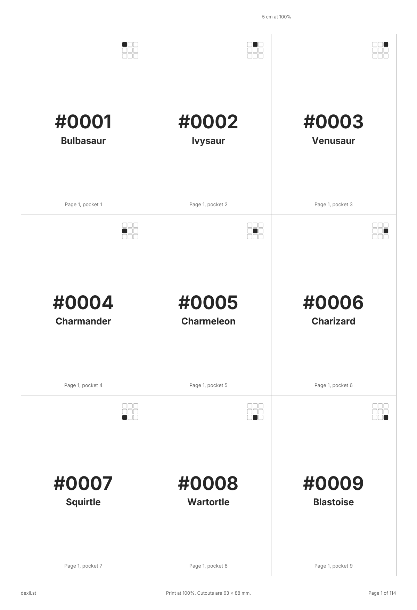

# National Pokédex binder placeholders

Printable placeholder cards for a Pokédex binder: one card-sized slip for each of the 1,025 Pokémon, in National Pokédex order, nine to a page. Print, cut, and put a slip in every pocket that is still waiting for its card.

## Files

| File | For |
| --- | --- |
| [national-pokedex-binder-placeholders-a4.pdf](national-pokedex-binder-placeholders-a4.pdf) | A4 paper, 114 pages |
| [national-pokedex-binder-placeholders-letter.pdf](national-pokedex-binder-placeholders-letter.pdf) | US Letter paper, 114 pages |
| [national-pokedex.csv](national-pokedex.csv) | Number, English name and generation of every species |

## Printing

- Print at 100%, not "fit to page". The 5 cm ruler at the top of each page tells you whether the scale is right.
- Each cutout is 63 × 88 mm, the size of a standard card.
- Every slip names its binder page and pocket for a 3 × 3 binder, and the small grid in its corner shows where it goes.

## A different layout

I made these with [dexli](https://dexli.st), my free Pokémon card collection tracker. Its [placeholder planner](https://dexli.st/guide/pokedex-binder) builds the same PDF for other setups: a single region, another pocket layout, A3 or Tabloid paper, card artwork on the slips, or names in German, Spanish, French, Italian, Japanese, Korean or Chinese. It can also print only the species you are still missing.

Free to print and share.

Pokémon and Pokémon character names are trademarks of Nintendo, Creatures and GAME FREAK. This is a fan project and is not affiliated with them.
